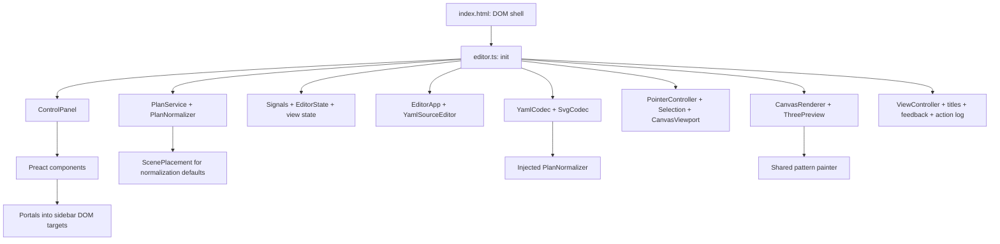
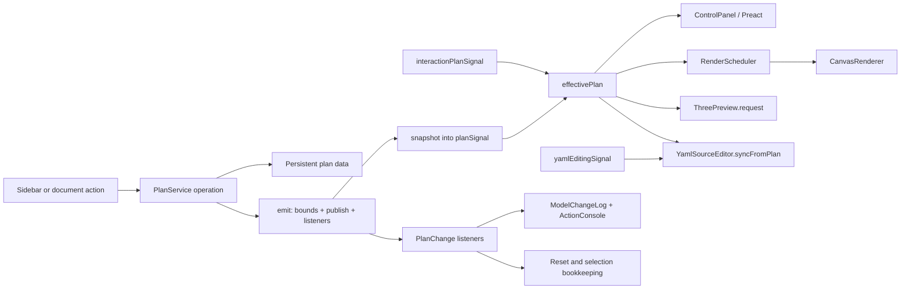
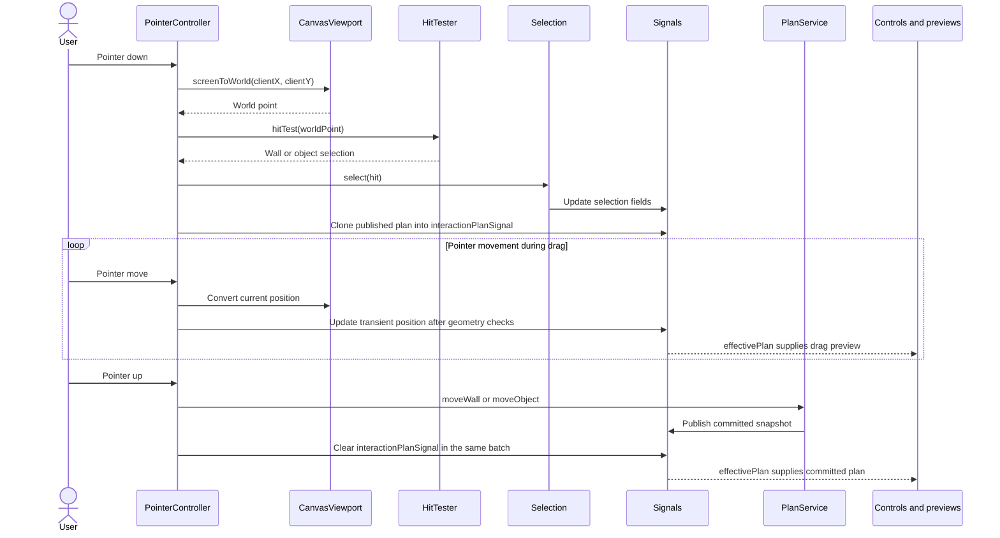
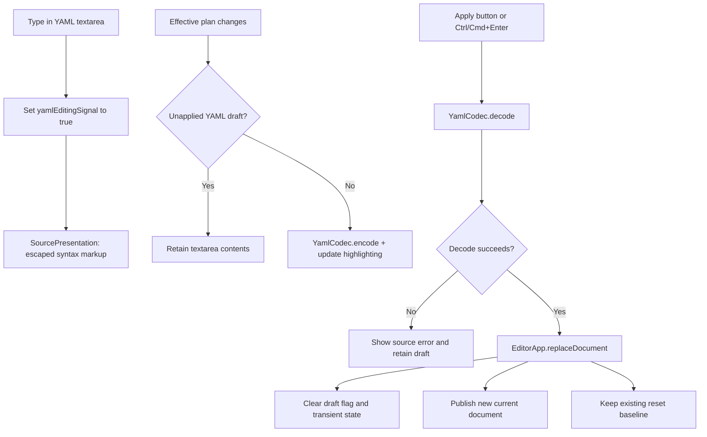
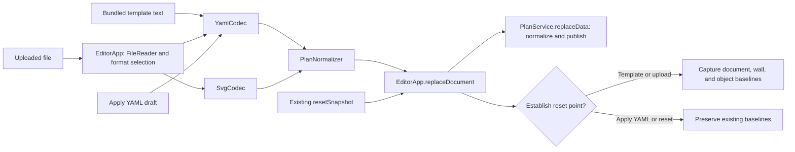
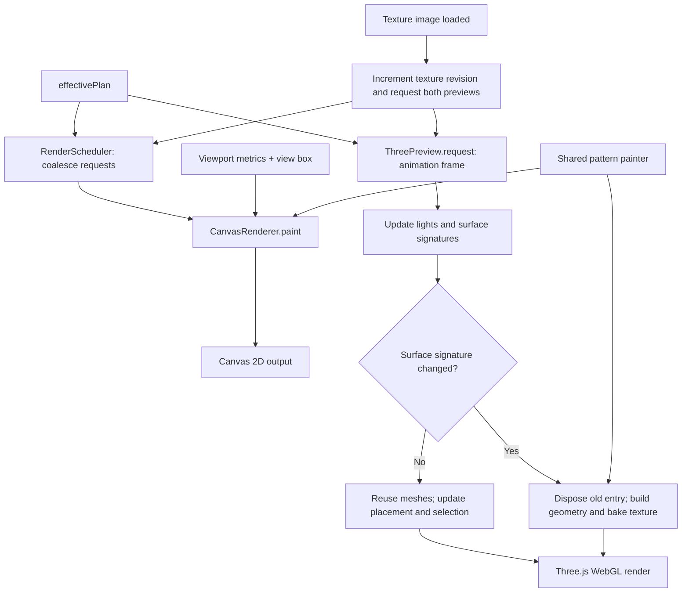

# Tiling editor architecture

This document describes the current TypeScript application: how it is assembled, who owns its state, and how user actions reach the model and previews. See [developer.md](developer.md) for the class reference and [user.md](user.md) for usage instructions.

The application runs in the browser with Preact, Signals, Canvas 2D, and Three.js. Vite provides development and the website build; esbuild produces a portable HTML edition. There is no application server or database; documents are loaded from files or the bundled template and exported through browser downloads.

The diagrams use Mermaid. Open Architecture documentation from the application's Documentation list to view the rendered diagrams, or use a Markdown viewer that supports Mermaid. The documentation viewer renders Markdown with Marked and DOMPurify, then lazily loads Mermaid to replace diagram blocks with SVG. Mermaid is bundled into the portable HTML and works offline. If a diagram cannot be rendered, its source remains visible.

## 1. Structure and responsibilities

`src/editor.ts` is the composition root. Its `init()` function creates instances, connects Signals and callbacks, installs top-level DOM listeners, and publishes the initial empty document. It also maintains reset snapshots and connects semantic model events to the action log.

Each class has its own TypeScript file. Stateful services and controllers use initialized instances. Preact components remain functions, split into focused modules under `src/ui/components/`.

| Location                                                    | Responsibility                                                                                                          |
| ----------------------------------------------------------- | ----------------------------------------------------------------------------------------------------------------------- |
| [index.html](../index.html)                                 | Static page shell, toolbar controls, canvas, sidebar targets, and documentation dialogs.                                |
| [src/editor.ts](../src/editor.ts)                           | Instance construction, dependency wiring, reactive effects, reset bookkeeping, and top-level actions.                   |
| [src/model/](../src/model/)                                 | Typed plan data, persistent mutations, input normalization, geometry, hit testing, and placement/layering calculations. |
| [src/codecs/](../src/codecs/)                               | YAML and SVG interchange, SVG transform helpers, and numeric formatting.                                                |
| [src/ui/](../src/ui/)                                       | Document lifecycle, source editing, selection, pointer interaction, view controllers, and feedback.                     |
| [src/ui/components/](../src/ui/components/)                 | Sidebar sections, cards, editable names, and reusable form controls.                                                    |
| [src/rendering/](../src/rendering/)                         | Canvas painting, render scheduling, shared pattern painting, and Three.js scene management.                             |
| [src/assets/base-model.yaml](../src/assets/base-model.yaml) | Bundled starter document, imported as text and loaded only on request.                                                  |
| [docs/](./)                                                 | User, developer, and architecture documentation.                                                                        |

This diagram shows construction and dependency wiring, rather than the order of individual user actions:



### Dependency injection and initialization

Controllers receive typed dependency objects or constructor arguments. For example, `ControlPanelDependencies` supplies the model service, reactive state, selection, reset callbacks, reordering controller, confirmation dialog, and sidebar portal targets. Components receive that object through their `context` prop; it is an ordinary typed prop, not a Preact Context provider. Controls such as `NumberField`, `Button`, and `PatternSelect` operate on their own props.

Some dependency properties use getters because the referenced controller or DOM element is initialized later. For example, `YamlSourceEditor` receives a lazy reference to `EditorApp`, while `EditorApp` receives the source editor. Constructors must leave these references unread until their targets exist. Getters and setters also keep replacement values such as `baseBox` and `resetSnapshot` connected to the entry point.

Methods passed directly to DOM listeners or animation callbacks are bound to their instance. Pointer listeners use arrow callbacks to preserve the receiver. This matters when moving code between modules: a detached method must still access the correct dependencies and state.

## 2. State ownership

`PlanService.data` is the authoritative persistent model. `snapshot()` returns a detached clone; changing a snapshot does not change the service. The runtime `Plan` contains patterns, walls, outlines, rectangular objects, pattern regions, placement, lights, and derived canvas bounds.

| State                   | Owner or access point                                                        | Purpose                                                                            |
| ----------------------- | ---------------------------------------------------------------------------- | ---------------------------------------------------------------------------------- |
| Persistent plan         | `PlanService.data`                                                           | Current document edited through model operations.                                  |
| Published plan          | `planSignal`                                                                 | Latest detached snapshot supplied to reactive consumers.                           |
| Drag preview            | `interactionPlanSignal`                                                      | Temporary plan while moving a wall or object.                                      |
| Displayed plan          | `effectivePlan`                                                              | Computed choice of drag preview, falling back to the published plan.               |
| Selection               | Selection Signals, exposed through `EditorState` accessors                   | Selected wall, object name, and object index shared by both previews and controls. |
| YAML draft              | Source textarea and `yamlEditingSignal`                                      | Editable text and whether automatic synchronization must be suspended.             |
| View box and zoom       | `view`, operated on by `CanvasViewport` and `ViewController`                 | Presentation state used for Canvas framing and interaction.                        |
| View visibility         | DOM toggles and `ViewController`                                             | Source, split view, and 2D/3D visibility.                                          |
| Light helper visibility | `lightVisibleSignal`                                                         | Display of source markers, aims, and direction helpers.                            |
| Reset baselines         | `resetSnapshot`, `wallResetSnapshots`, `objectResetSnapshots` in `editor.ts` | Whole-document and item reset targets.                                             |
| GPU resources           | `ThreePreview`                                                               | Cached scene objects, materials, textures, lights, and controls.                   |

Selection, camera position, zoom, visibility, and a YAML draft are outside serialized plan data. Canvas bounds are part of the runtime model but are derived from geometry rather than persisted in YAML. Legacy YAML canvas blocks are accepted and ignored.

## 3. Persistent model edits and reactive data flow

A sidebar component calls an operation such as `setObjectValue()` or `setPatternValue()` on `PlanService`. The service updates its data and emits a typed `PlanChange`. During emission it refreshes derived canvas bounds, calls the publication callback, and notifies semantic event listeners.

Publication assigns a fresh `snapshot()` to `planSignal`. Reactive effects in the entry point request painting, refresh the sidebar, and synchronize YAML when no unapplied draft exists. Model event listeners separately format action-log messages and maintain reset bookkeeping.



`effectivePlan` is conceptually:

```ts
interactionPlanSignal.value || planSignal.value;
```

This lets the sidebar, previews, hit tester, and automatic YAML view observe a drag preview without publishing each intermediate position as a persistent edit. Exports use `PlanService.snapshot()`, so serialized downloads come from the committed document.

Semantic events describe operations such as wall movement, object reordering, and plan renaming. They support logging and reset maintenance; the action console is not an undo/redo stack.

## 4. Pointer interaction and selection

`PointerController` attaches wheel and pointer listeners to the 2D preview. `CanvasViewport` converts browser client coordinates into viewport world coordinates. `HitTester` then applies the canvas Y flip and the wall transform, testing objects before outlines in reverse model order.

On a hit, the controller selects the item and starts a transient plan from the published snapshot. Movement beyond the click threshold updates that transient plan. Object movement is transformed into wall-local coordinates and checked with `GeometryTools.rectangleInsidePolygon()`.



A click without movement changes selection without committing a move. Dragging empty space pans the viewport, while wheel input and a two-touch pinch change view framing. These view operations do not mutate the document.

3D picking uses a different geometric mechanism but the same selection path. `ThreePreview` raycasts its scene and passes the semantic hit to the injected callback, which calls `Selection.select()`. Selection Signals drive Canvas markers, 3D highlighting, and opening the matching sidebar sections.

Sidebar ordering is a separate interaction. `ReorderHandle` stores the drag payload in `ReorderController`; card drop handlers call `reorderPattern()`, `reorderWall()`, or `reorderObject()` on `PlanService`. Object drops must target the same wall. Removal actions pass through `ConfirmationDialog` before invoking their model operation.

## 5. Editable YAML and document lifecycle

The YAML textarea is both a generated view of the effective plan and a draft editor. Typing sets `yamlEditingSignal` and updates `SourcePresentation` highlighting. While that flag is true, ordinary model changes continue to reach the controls and previews but automatic YAML synchronization leaves the draft untouched.



`YamlSourceEditor.apply()` decodes the draft before replacing the document. A successful replacement batches persistent replacement with clearing transient interaction and YAML editing state, clears selection, refreshes the title and view box, and requests 3D fitting. A decode failure is displayed in the source status area without replacing the plan.

Explicit template loading, uploading, and reset are document replacement actions, and clear the draft state. Draft protection applies to ordinary synchronization, not to replacing the document at the user's request.

### Import and reset paths



Codecs normalize decoded input, and `PlanService.replaceData()` normalizes the incoming document again at the model boundary. `PlanNormalizer` supplies defaults, derives canvas bounds, migrates legacy Y-up placements, and accepts the earlier single-light representation. Normalization is not comprehensive domain validation; codecs and model operations also perform their own checks.

| Action                  | Current document                                     | Reset baselines                                        |
| ----------------------- | ---------------------------------------------------- | ------------------------------------------------------ |
| Startup                 | Empty walls and patterns; template remains unloaded. | Empty document snapshot and initially empty item maps. |
| Load template or upload | Replace document and fit the view.                   | Capture the loaded document and its items.             |
| Apply YAML              | Replace current document and fit the view.           | Preserve existing baselines.                           |
| Reset document          | Replace current document with `resetSnapshot`.       | Preserve existing baselines.                           |
| Add wall or object      | Add through `PlanService`.                           | Record that new item's initial state.                  |
| Reset wall or object    | Restore the saved item through `PlanService`.        | Keep its reset target.                                 |

The entry point maintains item baselines on semantic events. Wall renaming moves baseline map keys, removals discard item baselines, and object reordering adjusts both baseline ordering and the selected object index.

### Export

YAML and SVG downloads encode a committed `PlanService.snapshot()` into a `Blob`. The browser downloads it through an object URL that is later revoked. `TitleController.downloadBaseName()` provides the filename. PNG export first paints the current effective plan synchronously, then calls `canvas.toBlob()`. Clipboard copy uses the current textarea contents, which can include an unapplied draft.

The YAML codec implements the project's limited indentation-sensitive format. The SVG codec uses plan-specific SVG structure and supported transform components; it rejects scripts and inline event handlers. Neither codec should be treated as a general document converter.

## 6. Rendering and coordinate conventions

Both previews use the same effective plan and the same pattern-painting function created by `createPatternPainter()`. Its texture image cache belongs to that painter instance. Image-load callbacks request a Canvas repaint, increment the 3D texture revision, and request a scene update.



### Canvas 2D

`RenderScheduler` coalesces redraw requests into one animation-frame callback. `CanvasRenderer` sizes the canvas for pixel density, applies the fitted view box and plan Y flip, clips tile patterns to outlines and regions, and draws objects, labels, dimensions, and selection markers. `ViewController` coordinates fitting and visibility; `CanvasViewport` owns the calculations used for pan, zoom, and pointer conversion.

### Three.js

`ThreePreview` is constructed during initialization, but imports Three.js and OrbitControls and creates its WebGL renderer only when activated. Its injected state callbacks read the effective plan, light-helper visibility, and selection. It owns the scene, camera, controls, cached surfaces, and light entries.

Surface cache keys use wall names. Signatures include outlines, regions, objects, used pattern definitions, and the texture revision. Placement-only changes update existing transforms; geometry or texture changes rebuild the affected surface. Removed or replaced entries dispose their geometry, materials, and textures. Light updates maintain light objects and their marker/helper resources.

| Coordinate space                | Convention                                                                                      |
| ------------------------------- | ----------------------------------------------------------------------------------------------- |
| Plan and wall-local geometry    | Millimeters; wall outlines and objects are transformed by the wall's 2D position and rotation.  |
| Canvas viewport world           | Coordinates before applying `plan.canvas.flipY`; `HitTester` converts them to plan coordinates. |
| 3D placement and light controls | Model positions are millimeters and angles are degrees.                                         |
| Three.js scene                  | Meters; floor lies on XY and Z is height. Wall-local height becomes world Z.                    |
| Object layering offsets         | Meters; saved object depths are converted from millimeters.                                     |

`ScenePlacement` supplies suggested positions when explicit placement is absent. `ObjectLayers` processes larger overlapping rectangles first so smaller items can sit in front of containers independently of model order. Room-facing surfaces receive tile textures; external faces use white materials.

Camera fitting uses room geometry, excluding light helpers. Fit room preserves the current direction; Perspective, Top, and Front choose explicit directions. Showing light markers does not change illumination or fitting bounds. Lighting includes configurable directional lights and hemisphere lighting.

## 7. Build, documentation, and verification

Vite reads `index.html` and builds the TypeScript entry point and its imports. YAML and documentation Markdown use `?raw` imports, so their text is bundled without runtime file requests. Three.js and OrbitControls are loaded through dynamic imports. The output is a static app with separate JavaScript and CSS assets under `dist/`, served locally with `npm run preview` or another HTTP server.

For handing over the app, [scripts/build-portable.mjs](../scripts/build-portable.mjs) bundles the same source with esbuild into `dist/tiling-editor.html`. CSS, raw assets, and JavaScript are inlined. Dynamic imports are bundled into the file, while WebGL initialization still occurs when the 3D preview is activated. The inline script uses the classic IIFE format, allowing direct `file://` opening without the CORS restrictions associated with local JavaScript modules. Closing script and style tags in embedded content are escaped before insertion into the HTML shell. This build uses no external resources for the bundled application and template.

`npm run build` creates both editions. `npm run build:portable` creates only the portable file. Both use the same source modules; the portable build adds no second application implementation. Changes to code, styles, or bundled documentation require rebuilding before handing over the file.

`initializeDocumentation()` connects the existing user and developer help buttons. On click, Marked parses the appropriate Markdown text and DOMPurify sanitizes the resulting HTML before it is inserted into the dialog. Documentation rendering is independent of model state.

Strict TypeScript checking runs before the production build. Prettier defines the source and documentation format. The main verification command is:

```sh
npm run check
```

| Check                     | Coverage                                                                                                                                             |
| ------------------------- | ---------------------------------------------------------------------------------------------------------------------------------------------------- |
| Formatting and TypeScript | Consistent formatting and compile-time model, component, and dependency contracts.                                                                   |
| Pattern and model tests   | Real TypeScript modules, model operations, serialization, placement, geometry, layering, and resource reuse.                                         |
| UI tests                  | Bundled source in jsdom: startup, sidebar actions, reordering, selection, reactive updates, draft protection, and dialogs.                           |
| Markdown tests            | Markdown output and HTML sanitization.                                                                                                               |
| Built-app smoke test      | Emitted production code, asset serving through Vite preview, startup, documentation, and template loading.                                           |
| Portable smoke test       | HTML copied to an isolated folder, executed through a file URL with no external resources; startup, template, help, YAML application, and downloads. |

The automated UI tests use real Three.js geometry with mocked WebGL rendering. The built-app test also mocks Canvas and rebundles emitted JavaScript for jsdom. Real-browser checks are needed to verify native module loading, GPU output, and pointer behavior.

Known model/interchange gaps include YAML omission of outline styling, SVG omission of pattern regions, empty-plan YAML reimport, and duplicate wall-name normalization. Architecture changes must not silently assume these contracts are already complete.

## 8. Extending the setup

For a persistent feature, add its types and input defaults in `src/model/`, implement an operation and semantic event in `PlanService`, then connect a focused sidebar component. Update codecs and both renderers where the feature belongs to their contracts. Persistent edits should continue to flow through the service rather than changing a published snapshot.

For a presentation feature, keep state in a controller, view state, or Signal outside serialization. Pass dependencies from the entry point, preserve callback binding, and use the effective plan when the feature needs to follow transient dragging. Keep reusable form components independent of the application dependencies where possible.

For a document-lifecycle change, define its draft, selection, fitting, and reset-baseline behavior explicitly. Validate those paths with integration tests, including a pending YAML draft and an existing reset target. The [class reference](developer.md#class-reference) and class JSDoc provide the detailed entry points for implementation.
